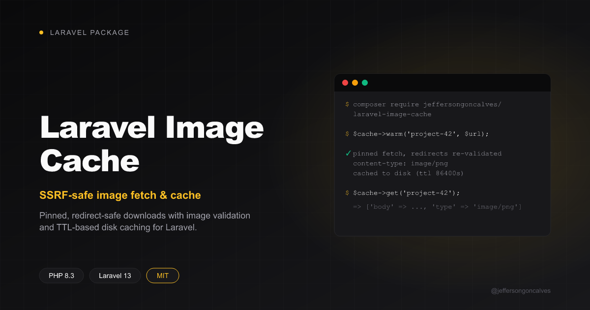

<div class="filament-hidden">



</div>

# Laravel Image Cache

[](https://packagist.org/packages/jeffersongoncalves/laravel-image-cache)
[](https://github.com/jeffersongoncalves/laravel-image-cache/actions?query=workflow%3ATests+branch%3Amain)
[](https://github.com/jeffersongoncalves/laravel-image-cache/actions?query=workflow%3A"Fix+PHP+code+styling"+branch%3Amain)
[](https://packagist.org/packages/jeffersongoncalves/laravel-image-cache)
[](LICENSE.md)

Fetching a user-supplied or third-party image URL and re-serving it from your own origin (an `og:image`, a README-embedded image, an avatar) needs three things done correctly every time: the fetch must be safe against SSRF (pinned to a validated public IP, every redirect hop re-checked), the response must actually be an image before you store it, and repeat requests should be served from a local, TTL-based cache instead of re-fetching on every hit.

Laravel Image Cache packages that fetch-and-persist mechanic behind a small class you construct per use-site:

```php
$cache = new ImageCache(disk: 'public', pathPrefix: 'og-images', ttlSeconds: 86400);

$cache->warm('project-42', $untrustedImageUrl);
```

It does **not** decide which URL to fetch for a given key (that's app-specific — resolve it from a model, parse it out of HTML, whatever fits your app) or which hosts are allowed (that's also a caller decision). What it guards is *where the URL you already decided to fetch actually resolves to* — via [`jeffersongoncalves/laravel-ssrf-guard`](https://github.com/jeffersongoncalves/laravel-ssrf-guard).

## Installation

You can install the package via composer:

```bash
composer require jeffersongoncalves/laravel-image-cache
```

You can publish the config file with:

```bash
php artisan vendor:publish --tag="image-cache-config"
```

This is the published config file:

```php
return [
    'timeout' => (int) env('IMAGE_CACHE_TIMEOUT', 8),
    'max_redirects' => (int) env('IMAGE_CACHE_MAX_REDIRECTS', 3),
    'failure_ttl' => (int) env('IMAGE_CACHE_FAILURE_TTL', 3600),
    'max_bytes' => (int) env('IMAGE_CACHE_MAX_BYTES', 10 * 1024 * 1024),
];
```

## Usage

Construct an `ImageCache` per use-site with the Laravel disk to store on, a path prefix, and a TTL (defaults to 24 hours):

```php
use JeffersonGoncalves\ImageCache\ImageCache;

$cache = new ImageCache(disk: 'public', pathPrefix: 'og-images', ttlSeconds: 86400);
```

### Warming the cache

`warm()` fetches and persists the image if the disk copy is missing or older than the TTL. It no-ops (returns `true`) when already fresh, and **never throws** — any failure (network error, non-2xx, non-image content type, a redirect into a non-public host) is logged as a warning and `false` is returned, leaving any existing stale copy untouched. Serving yesterday's copy beats erroring. A failed fetch is also remembered for `failure_ttl` seconds (`recentlyFailed($key)`), so an upstream that is gone is not hit again on every request:

```php
$cache->warm(key: 'project-42', url: $project->social_image);
```

By default `warm()` validates and pins the URL itself via `SsrfGuard::resolveEntries()`. If you already resolved/validated the URL yourself (for example you called `resolveEntries()` earlier to decide whether the source even has an image, and don't want a second DNS lookup), pass the resulting `CURLOPT_RESOLVE` entries directly:

```php
use JeffersonGoncalves\SsrfGuard\SsrfGuard;

$resolve = app(SsrfGuard::class)->resolveEntries($url);

if ($resolve !== null) {
    $cache->warm('project-42', $url, $resolve);
}
```

Passing an empty array (`[]`) skips pinning entirely — useful for a URL you already trust unconditionally (e.g. a fixed first-party API endpoint) and don't need DNS-rebinding protection for.

### Reading back a cached image

```php
$image = $cache->get('project-42');
// ['body' => '<binary>', 'type' => 'image/png'] or null if never warmed successfully
```

### Serving it from a controller

`response()` is a thin convenience wrapper around `get()` for the common controller case — it returns a ready-to-send response with the right `Content-Type` and `X-Content-Type-Options: nosniff`, or `null` when the key was never warmed:

```php
public function show(string $slug)
{
    return $cache->response($slug) ?? abort(404);
}
```

For an `` you would rather not break, answer with a 1x1 transparent GIF instead of a 404:

```php
return $cache->response($key) ?? ImageCache::placeholder();
```

### Storage layout and pruning

Image bodies are stored once per content, under `<prefix>/blobs/<sha256>`; each key is a tiny JSON pointer (`{"blob": "<sha256>", "type": "image/png"}`) at `<prefix>/<key>`. The same image reached through different URLs (say, one README on several branches) therefore takes the disk space of a single copy. Caches written by older versions (`<key>` body + `<key>.type`) are still read, and move to the new layout the next time the key is warmed.

When a key is re-warmed with different bytes, its old blob is left behind. `prune()` deletes every blob no key points at (blobs younger than an hour are kept, so an in-flight `warm()` is never raced) and returns how many it removed. It scans the whole prefix, so schedule it instead of calling it per request:

```php
Schedule::call(fn () => (new ImageCache('public', 'og-images'))->prune())->daily();
```

Using a bucket lifecycle rule on a remote disk instead? Never expire `<prefix>/blobs/` by age alone: a blob can be shared by keys that are still fresh.

## Configuration

| Key | Default | Description |
|-----|---------|-------------|
| `timeout` | `8` | Maximum seconds a `warm()` fetch may run. |
| `max_redirects` | `3` | How many redirect hops to follow — each one is re-validated against `SsrfGuard`. |
| `failure_ttl` | `3600` | Seconds `warm()` skips the upstream after a failed fetch (`0` retries every time). |
| `max_bytes` | `10485760` | Largest image (bytes) `warm()` stores; bigger ones abort mid-download and count as a failed fetch (`0` = unlimited). |

## Testing

```bash
composer test
```

## Changelog

Please see [CHANGELOG](CHANGELOG.md) for more information on what has changed recently.

## Contributing

Please see [CONTRIBUTING](.github/CONTRIBUTING.md) for details.

## Security

Please review [our security policy](.github/SECURITY.md) on how to report security vulnerabilities.

## Credits

- [Jefferson Gonçalves](https://github.com/jeffersongoncalves)
- [All Contributors](../../contributors)

## License

The MIT License (MIT). Please see [License File](LICENSE.md) for more information.
